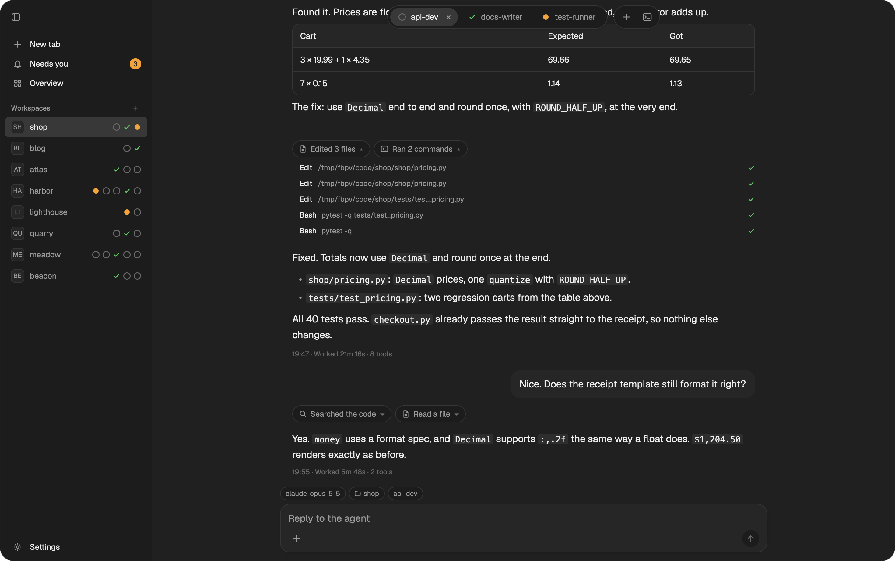
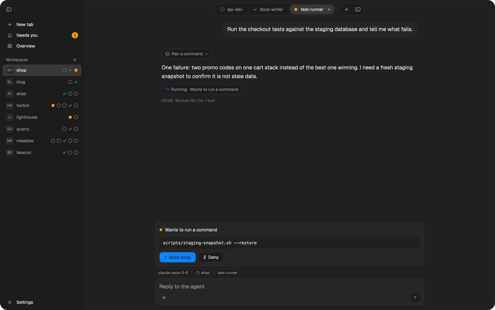
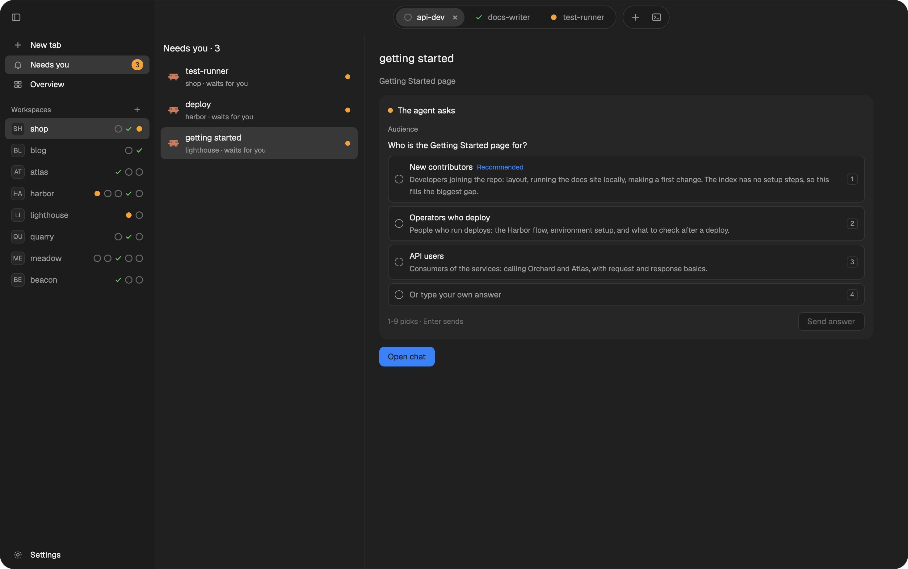
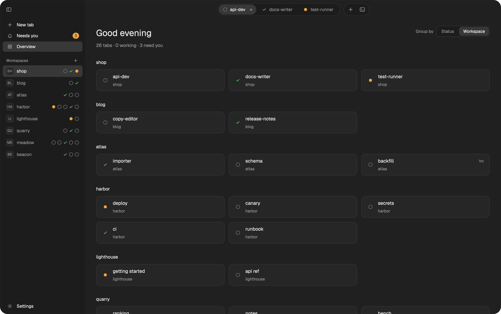
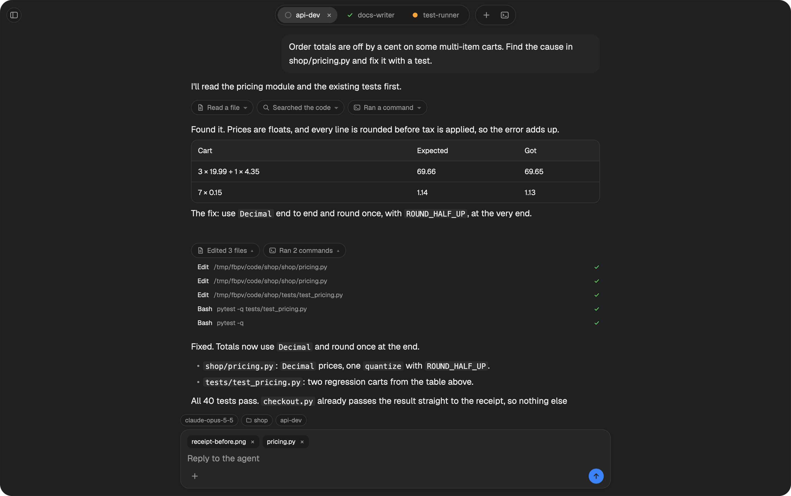
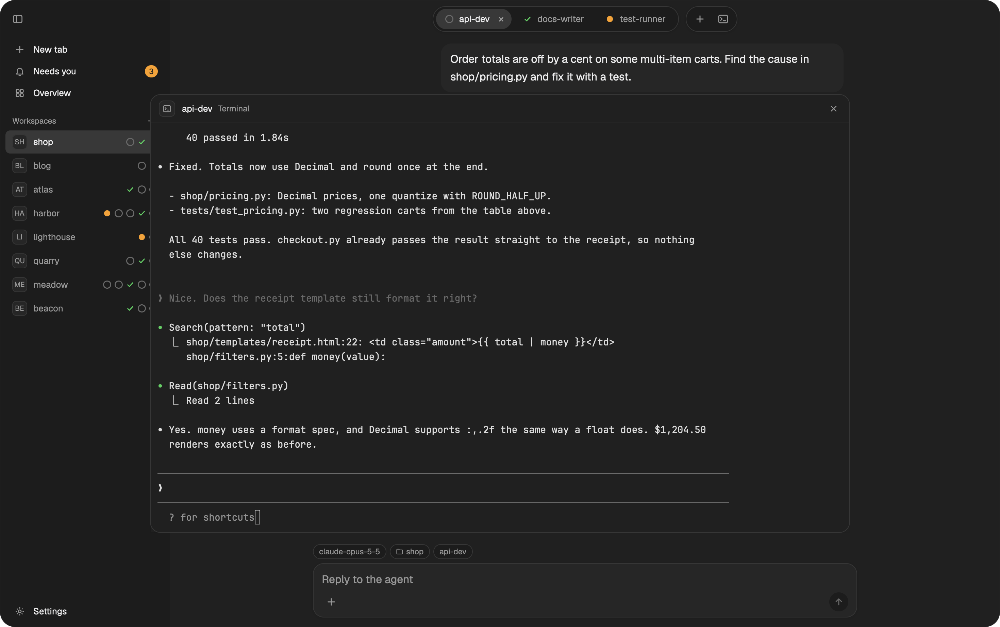
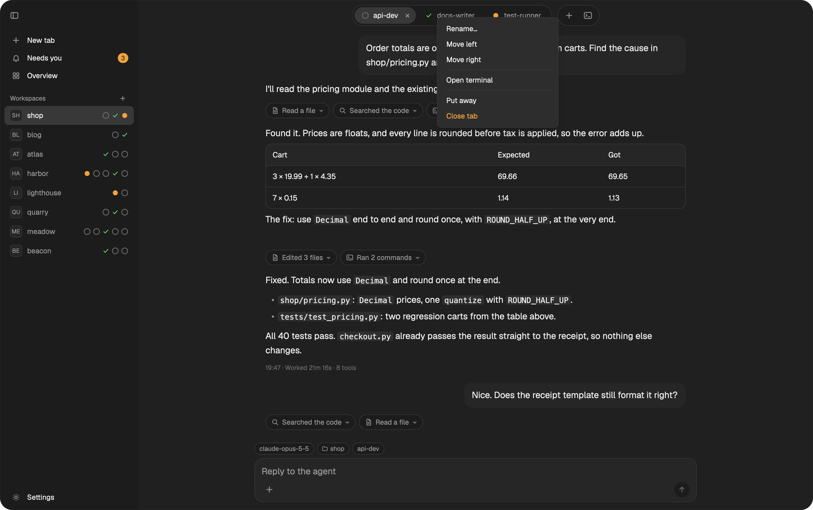
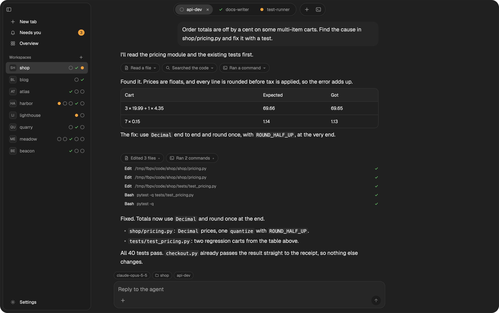
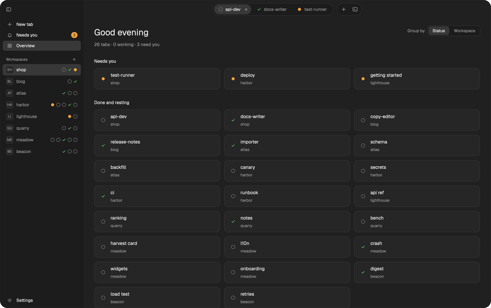
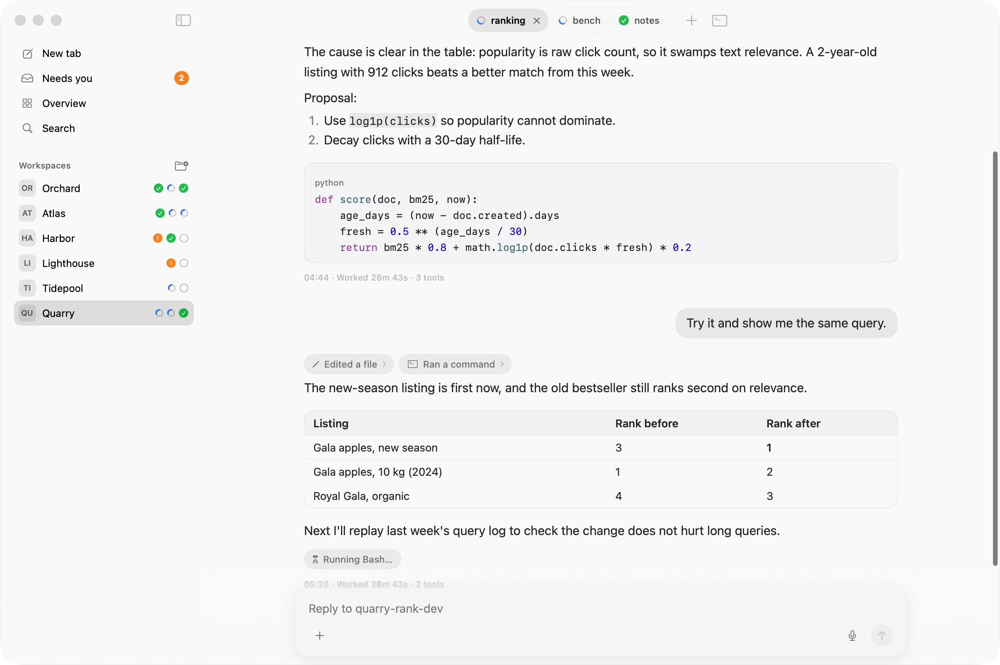

# Flockbook

> **Unofficial.** Flockbook is not affiliated with, endorsed by, or supported by Herdr, Inc. It uses only Herdr's public APIs.

Flockbook is a reading view for your [Herdr](https://herdr.dev) coding agents. Read what each agent did, see which one needs you, and reply in one place.

It comes in two forms: a **layout and mod for the Herdr app** (macOS and Linux), where new work goes, and a **native macOS app**.

**Built with AI.** AI coding agents write Flockbook: Claude Code writes the code, and a separate AI reviewer (Codex or Claude) checks each change. A human sets the direction, tests the app, and reviews every change. See [How this was built](#how-this-was-built).

## Quick start

Install the Herdr app mod on macOS or Linux:

```sh
curl -fsSL https://github.com/minchenlee/flockbook/releases/latest/download/install.sh | sh
```

Then, in the Herdr app, run `layout.switch {"name": "flockbook"}`. `ctrl-shift-l` switches back to your own layout. To see the plan first, add `-s -- --dry-run` after `sh`; nothing is written. [Install](#install) has the other ways.

For the Mac app, see [Flockbook for Mac](#flockbook-for-mac).

## Flockbook for the Herdr app



The reading view runs inside the Herdr app window, with no change to the app:

- **Chat**: each tab with an agent shows as a conversation. Replies are Markdown with code boxes and tables; tool calls fold into short chips.
- **Since you left**: back on a chat after 5 minutes or more, a card says how long you were away, how many messages came, and what the log shows. Turn on **Summaries** (off by default) and a model adds two lines: the state of the work, and what it needs from you.
- **"/" menu**: type `/` in the reply box to see the agent's commands, skills and command files.
- **Tab bar**: one capsule per tab, with its status: working, waiting for you, done or idle.
- **Approval and question cards**: answer a permission prompt or a question above the reply box.
- **Needs you** lists every agent that waits. **Overview** shows every tab as a card.
- **Sidebar** with your spaces. ⌘B shows and hides it; hidden, it slides out from the window's left edge.
- **Terminal**: the agent's real terminal is one key away (⌃`).

<table>
<tr><td width="50%" valign="top"><br><sub><b>Approval card</b>: allow or deny a permission prompt above the reply box (1 / 2).</sub></td><td width="50%" valign="top"><br><sub><b>Needs you</b>: every agent that waits, with its question or approval card.</sub></td></tr>
<tr><td width="50%" valign="top"><br><sub><b>Overview by workspace</b>: every tab as a card, in its workspace.</sub></td><td width="50%" valign="top"><br><sub><b>Reply box</b>: drop files or click + to attach them; ⌘V pastes an image.</sub></td></tr>
<tr><td width="50%" valign="top"><br><sub><b>Terminal</b>: ⌃` opens the agent's real terminal over the chat.</sub></td><td width="50%" valign="top"><br><sub><b>Tab menu</b>: right-click a tab to rename or move it, open its terminal, put it away or close it.</sub></td></tr>
<tr><td width="50%" valign="top"><br><sub><b>Floating sidebar</b>: hidden, it slides out when the pointer reaches the window's left edge.</sub></td><td width="50%" valign="top"><br><sub><b>Overview by status</b>: the agents that need you first, then the rest.</sub></td></tr>
</table>

A small helper, `flockbook-modfeed`, reads the agents' session logs for the chat. The cards follow the same safety rules as the Mac app: each key checks first that the terminal still shows the same agent and the same prompt, one approval goes out once per prompt, and a reply goes only to the conversation the chat showed.

### Install

**In one line** (macOS or Linux): the command in [Quick start](#quick-start). It downloads the helper for your machine from the latest release, checks it against the release's `SHA256SUMS`, and runs `flockbook-modfeed install`.

**From the release zip**, to look first: download `Flockbook-herdr-mod-<version>.zip` from the [latest release](https://github.com/minchenlee/flockbook/releases/latest). It has the layout, the mod and the helper for every platform. Unzip it, then:

```sh
./install.sh --dry-run   # see what it does; nothing is written
./install.sh
```

**From the [Herdr layout gallery](https://herdr.dev/gallery/)**: the gallery copies the layout and the mod, but not the helper, so the chat says the helper is missing. Run the one-line install too; it upgrades a gallery copy that nobody changed.

The install never overwrites what you have: if a layout, mod or theme called flockbook is there and it did not put it there, it stops and writes nothing. An older Flockbook that nobody changed (a gallery copy, an older zip) is upgraded in place. [herdr-app/README.md](herdr-app/README.md) has the details, and [herdr-app/RECIPE.md](herdr-app/RECIPE.md) describes every part of the mod.

#### Uninstall

There is no uninstall command. Remove the files by hand. The paths below are in the herdr-app home: `~/.config/herdr-app` by default, else `$HERDR_APP_HOME` or the `--home` you gave the install. Do steps 1 and 2 while the Flockbook layout still shows.

1. If you turned on the Phone page, turn it off in Flockbook settings (⌘⇧,). This stops the service and removes its file: `~/Library/LaunchAgents/dev.flockbook.serve.plist` on macOS, `~/.config/systemd/user/flockbook-serve.service` on Linux.
2. If Flockbook put its helper on another machine, right-click a tab on that machine and choose **Remove helper from …**. (The item shows only when Helper on other machines is Ask.) This deletes `~/.local/share/flockbook/helper` there. Then delete `~/.cache/flockbook` on that machine by hand.
3. Press `ctrl-shift-l` to switch back to your own layout.
4. Delete these from the herdr-app home:
   - `layouts/flockbook.json`
   - `mods/flockbook/` (the whole folder)
   - `themes/flockbook.json`, `themes/flockbook-light.json`, `themes/flockbook-mac.json` and `themes/flockbook-mac-light.json`
   - `flockbook/` (the whole folder). It holds the helper (`bin/`), the helpers for other machines (`remote/`), `install.json`, your Flockbook settings (`config.json`), pasted images (`paste/`), the Phone page's files (`serve/`, `uploads/`) and the helper's state, such as `cache.json`, `answered/`, `resources/`, `glance.json`, `glance-marks.json`, `remote.json`, `summary.json`, `summary-usage.jsonl` and `update-check.json`.
   - `layouts/.state/flockbook.json`, if it is there. Flockbook reads it to know if the sidebar was open.
5. In `keys.json`, remove the `"layout:flockbook"` section. The install adds keys only to that section. If you added your own keys to it, remove only the Flockbook keys: they are listed in [herdr-app/keys.json](herdr-app/keys.json). A key that you set before the install kept your command, so it is yours.
6. If you used the Phone page, also delete `~/.flockbook/serve/` and, on macOS, `~/Library/Logs/flockbook-modfeed-serve.log`.

`flockbook/install.json` lists each layout, mod and theme file that the install wrote, with its SHA-256. Read it to see what Flockbook put in the home before you delete. A file whose hash is different is one you changed. The list does not include `keys.json` or the helpers.

**Status: preview.** Built and tried on macOS; the helper also runs on Linux (x86_64 and arm64), where the + file dialog is off (drop files or paste an image instead). Agents it reads: Claude Code, Codex, Grok Build, Cursor, pi, oh-my-pi (omp) and Antigravity CLI (agy). omp needs version 18.9 or later: older omp does not report its status (OSC 7501), so Herdr does not list it as an agent and its tab shows the terminal (run `omp update`).

## Flockbook for Mac

A native macOS app (macOS 15 or later) with the same reading view, outside the Herdr app. It also has remote access from your phone over Tailscale, phone notifications, queued messages and an embedded terminal. The "Since you left" card and Summaries come to the Mac app in a later release.

**[Download for macOS](https://github.com/minchenlee/flockbook/releases/tag/v0.13.1)** · [Website](https://flockbook.mclee.dev) · [Features, remote access and build](docs/mac-app.md)

<picture>
  <source media="(prefers-color-scheme: dark)" srcset="docs/media/conversation-dark.png">
  
</picture>

## Linux and Windows (in progress)

The Rust code in `xplat/` is an early port of Flockbook to Linux and Windows, built with [iced](https://iced.rs). It is not released yet, and it is the reason this repository shows Rust. The macOS app is the Swift code at the repository root and does not use `xplat/`.

## Privacy

Flockbook runs locally. It reads agent session logs on your Mac (`~/.claude/projects/`, `~/.codex/sessions/`, `~/.grok/sessions/`, `~/.cursor/projects/`, `~/.pi/agent/sessions/`, `~/.omp/agent/sessions/`, `~/.gemini/antigravity-cli/`) and talks to Herdr through its local socket. It has no telemetry. It goes on the network only for the hourly update check (you can turn it off) and, when you turn them on, for remote access over Tailscale or your local network and for phone notifications through the phone's push service. The Herdr app mod and its helper read the same session logs and talk to herdr-core (`hc`) on your Mac; they go on the network only to check api.github.com once a day for a newer release (turn it off in the mod's Flockbook settings).

In the Herdr app mod, Summaries are off by default. When they are on, the helper runs a coding agent's program (Claude Code, Codex or pi) once for each finished turn of an agent on this machine. The program gets your last message (at most 1,500 characters), the end of the agent's reply (at most 6,000 characters) and one line of facts from the log (files edited, commands run, the last failed command, the test state). It sends this text to its model provider under your account. With the default choice, **Each agent's own**, it is the program of the agent that wrote the turn, so the text goes where the conversation already went; an agent of another program gets no summary. Flockbook sends the text nowhere else. It keeps only the latest summary of each agent in `flockbook/summary.json`, and a count of each run, with no text, in `flockbook/summary-usage.jsonl`.

## How this was built

Flockbook was developed with extensive help from AI: [Claude Code](https://claude.com/claude-code) (Anthropic) writes most of the code, and a separate AI reviewer (Codex or Claude) checks each change. The repository is open; read the code and judge it on its merits.

<details>
<summary>About the process</summary>

My role is direction, not authorship:

- Product direction: deciding what to build and why
- Testing: using the app every day, finding bugs, checking that features behave
- Review: reading the changes before they land, with an AI review on top for security and correctness
- Measurement: hang and performance fixes are checked with real samples and timings on my own Mac

I'm disclosing this because it's true and because the code should stand on its own. If something is wrong, [open an issue](https://github.com/minchenlee/flockbook/issues).

</details>

## Contributing

Pull requests are welcome, including ones written with AI tools. Read [CONTRIBUTING.md](CONTRIBUTING.md) first: it tells you how to build, test, and send a change. Ask questions and suggest features in [Discussions](https://github.com/minchenlee/flockbook/discussions). Report security problems as [SECURITY.md](SECURITY.md) says.

## Contributors

Thanks to everyone who has contributed to Flockbook:

<!-- ALL-CONTRIBUTORS-LIST:START - Do not remove or modify this section -->
<!-- prettier-ignore-start -->
<!-- markdownlint-disable -->
<table>
  <tbody>
    <tr>
      <td align="center" valign="top" width="14.28%"><a href="https://github.com/minchenlee"><br /><sub><b>Min-Chen Lee</b></sub></a><br /><a href="#code-minchenlee" title="Code">💻</a> <a href="#doc-minchenlee" title="Documentation">📖</a> <a href="#design-minchenlee" title="Design">🎨</a> <a href="#infra-minchenlee" title="Infrastructure (Hosting, Build-Tools, etc)">🚇</a></td>
      <td align="center" valign="top" width="14.28%"><a href="https://github.com/AgustinRamiroDiaz"><br /><sub><b>Agustín Díaz</b></sub></a><br /><a href="https://github.com/minchenlee/flockbook/commits?author=AgustinRamiroDiaz" title="Code">💻</a> <a href="#platform-AgustinRamiroDiaz" title="Packaging/porting to new platform">📦</a></td>
      <td align="center" valign="top" width="14.28%"><a href="https://github.com/choru-k"><br /><sub><b>Cheol Kang</b></sub></a><br /><a href="https://github.com/minchenlee/flockbook/commits?author=choru-k" title="Code">💻</a></td>
      <td align="center" valign="top" width="14.28%"><a href="https://github.com/OMKE"><br /><sub><b>Omar Iriskic</b></sub></a><br /><a href="https://github.com/minchenlee/flockbook/commits?author=OMKE" title="Code">💻</a></td>
    </tr>
  </tbody>
</table>

<!-- markdownlint-restore -->
<!-- prettier-ignore-end -->

<!-- ALL-CONTRIBUTORS-LIST:END -->

See [CONTRIBUTORS.md](CONTRIBUTORS.md) for the full list and what each person did.

## License

MIT. See [LICENSE](LICENSE) and [THIRD_PARTY_NOTICES.md](THIRD_PARTY_NOTICES.md).
