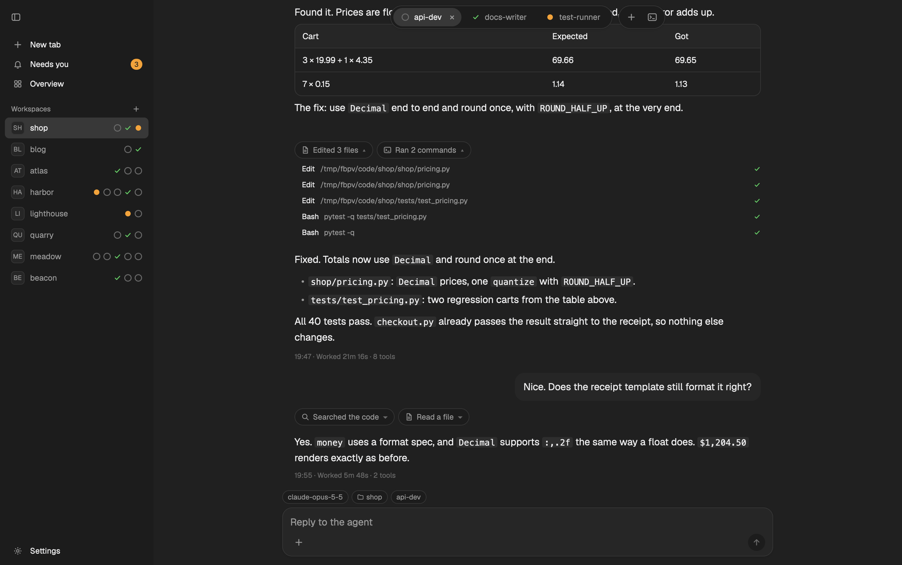
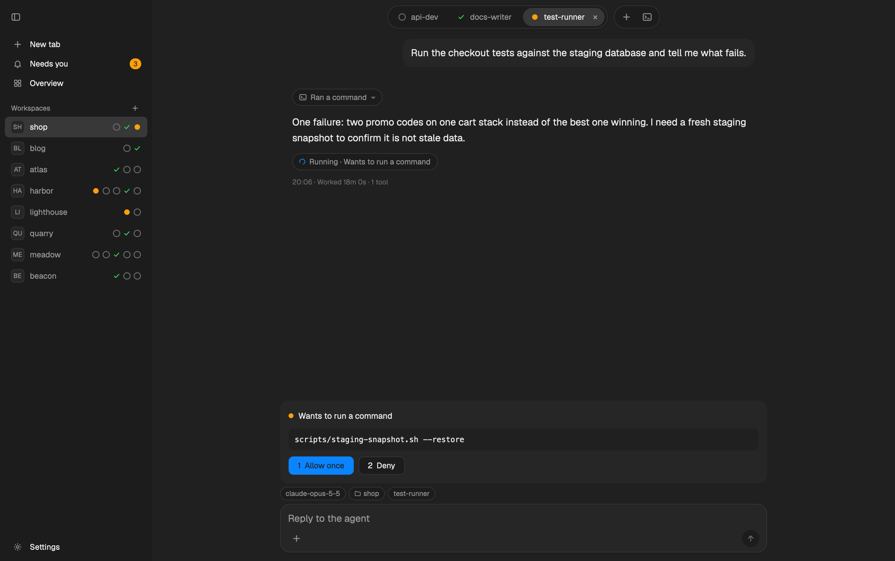
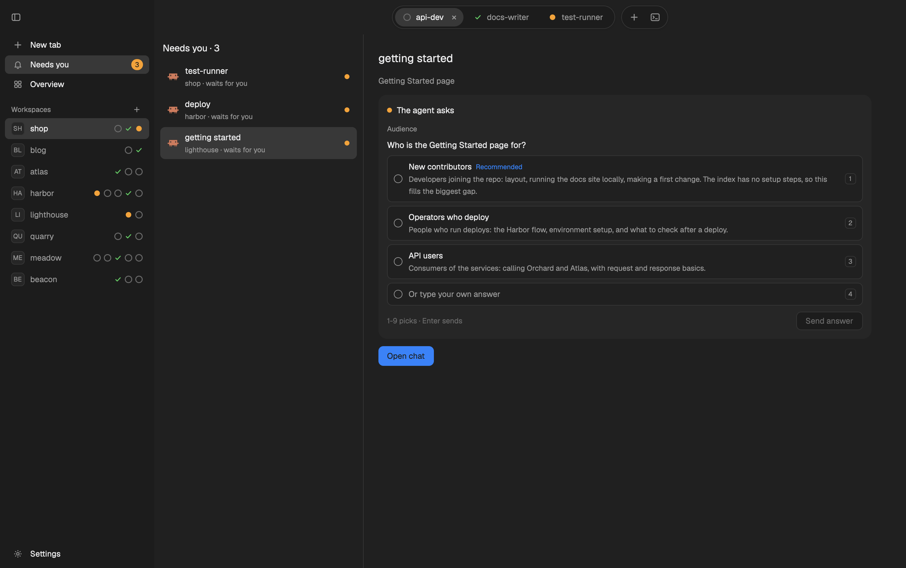
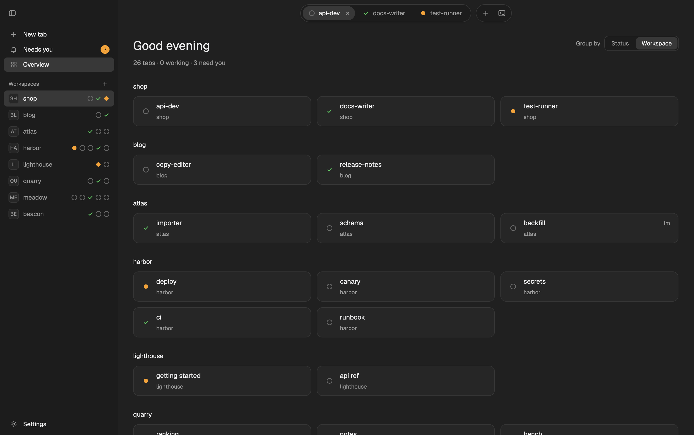
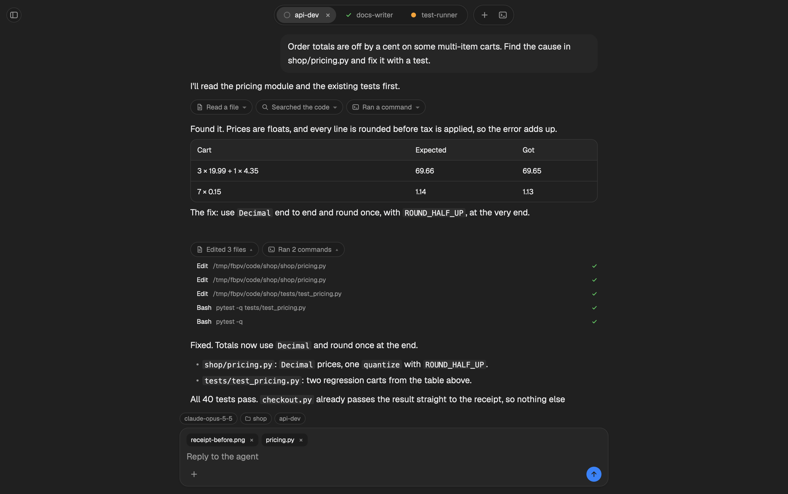
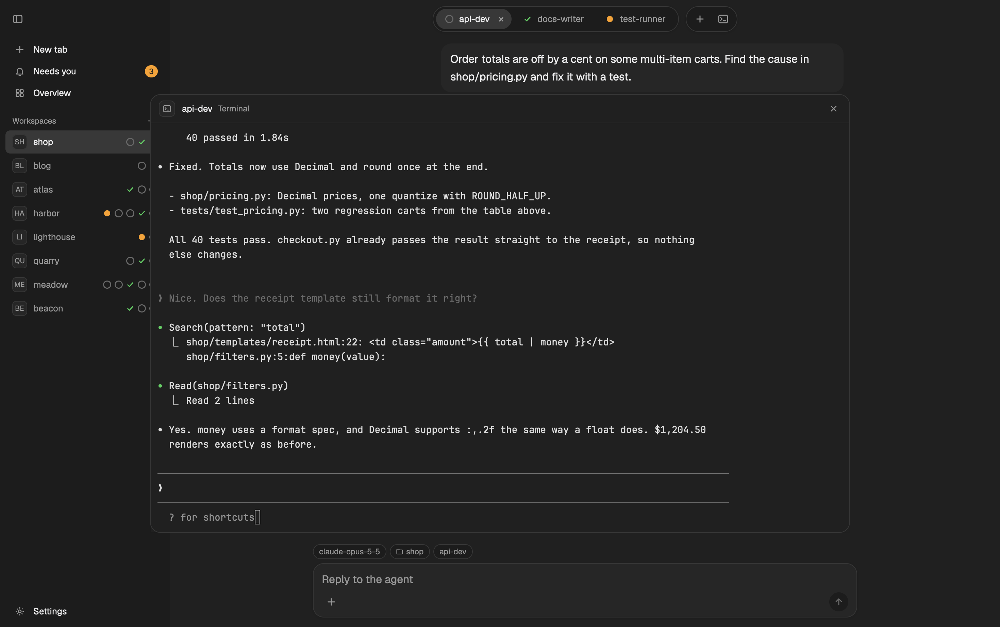
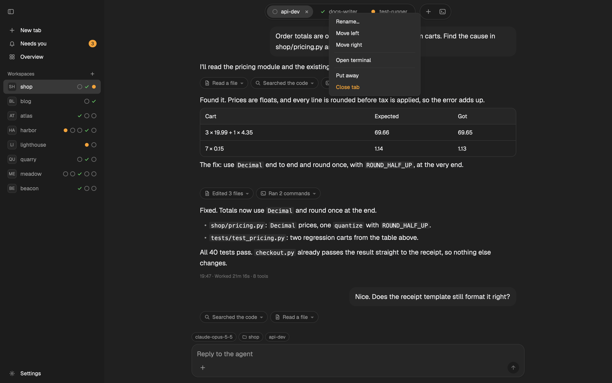
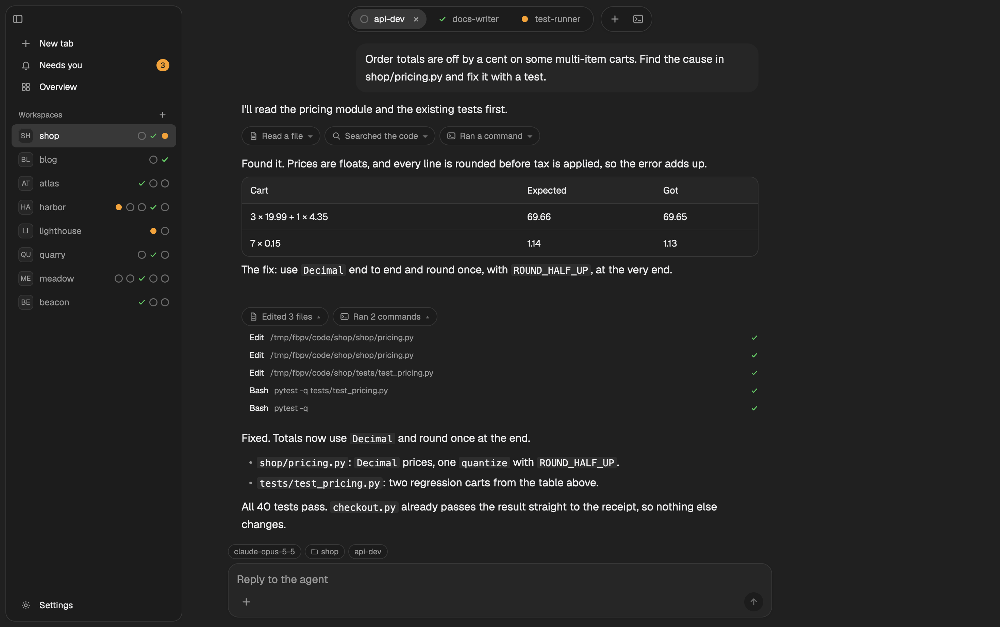
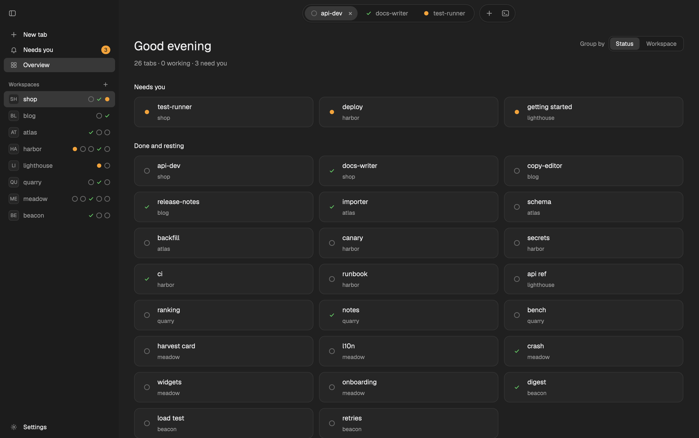

# Flockbook

> **Unofficial.** Flockbook is not affiliated with, endorsed by, or supported by Herdr, Inc. It uses only Herdr's public APIs.

Flockbook is a reading view for your [Herdr](https://herdr.dev) coding agents. Read what each agent did, see which one needs you, and reply in one place.

It comes in two forms: a **layout and mod for the Herdr app**, where new work goes, and a **native macOS app**.

**Built with AI.** AI coding agents write Flockbook: Claude Code writes the code, and a separate AI reviewer (Codex or Claude) checks each change. A human sets the direction, tests the app, and reviews every change. See [How this was built](#how-this-was-built).

## Flockbook for the Herdr app



The reading view runs inside the Herdr app window, with no change to the app:

- **Chat**: each tab with an agent shows as a conversation. Replies are Markdown with code boxes and tables; tool calls fold into short chips.
- **Tab bar**: one capsule per tab, with its status: working, waiting for you, done or idle.
- **Approval and question cards**: answer a permission prompt or a question above the reply box.
- **Needs you** lists every agent that waits. **Overview** shows every tab as a card.
- **Sidebar** with your spaces. ⌘B shows and hides it; hidden, it slides out from the window's left edge.
- **Terminal**: the agent's real terminal is one key away (⌃`).

<table>
<tr><td width="50%" valign="top"><br><sub><b>Approval card</b>: allow or deny a permission prompt above the reply box (1 / 2).</sub></td><td width="50%" valign="top"><br><sub><b>Needs you</b>: every agent that waits, with its question or approval card.</sub></td></tr>
<tr><td width="50%" valign="top"><br><sub><b>Overview by workspace</b>: every tab as a card, in its workspace.</sub></td><td width="50%" valign="top"><br><sub><b>Reply box</b>: drop files or click + to attach them; ⌘V pastes an image.</sub></td></tr>
<tr><td width="50%" valign="top"><br><sub><b>Terminal</b>: ⌃` opens the agent's real terminal over the chat.</sub></td><td width="50%" valign="top"><br><sub><b>Tab menu</b>: right-click a tab to rename or move it, open its terminal, put it away or close it.</sub></td></tr>
<tr><td width="50%" valign="top"><br><sub><b>Floating sidebar</b>: hidden, it slides out when the pointer reaches the window's left edge.</sub></td><td width="50%" valign="top"><br><sub><b>Overview by status</b>: the agents that need you first, then the rest.</sub></td></tr>
</table>

A small helper, `flockbook-modfeed`, reads the agents' session logs for the chat. The cards follow the same safety rules as the Mac app: each key checks first that the terminal still shows the same agent and the same prompt, one approval goes out once per prompt, and a reply goes only to the conversation the chat showed.

### Install

On macOS or Linux, in one line:

```sh
curl -fsSL https://github.com/minchenlee/flockbook/releases/latest/download/install.sh | sh
```

It downloads the helper for your machine from the latest release, checks it against the release's `SHA256SUMS`, and runs `flockbook-modfeed install`. Add `-s -- --dry-run` after `sh` to see the plan first.

To look first: download `Flockbook-herdr-mod-<version>.zip` from the [latest release](https://github.com/minchenlee/flockbook/releases/latest). It has the layout, the mod and the helper for every platform. (It is also listed in the [Herdr layout gallery](https://herdr.dev/layouts/minchenlee/flockbook--herdr-app/).) Unzip it, then:

```sh
./install.sh --dry-run   # see what it does; nothing is written
./install.sh
```

The install never overwrites what you have: if a layout, mod or theme called flockbook is there and it did not put it there, it stops and writes nothing. [herdr-app/README.md](herdr-app/README.md) has the details, and [herdr-app/RECIPE.md](herdr-app/RECIPE.md) describes every part of the mod.

**Status: preview.** Built and tried on macOS; the helper also runs on Linux (x86_64 and arm64), where the + file dialog is off (drop files or paste an image instead). Agents it reads: Claude Code, Codex, Grok Build, Cursor, pi and Antigravity CLI (agy).

## Flockbook for Mac

A native macOS app (macOS 15 or later) with the same reading view, outside the Herdr app. It also has remote access from your phone over Tailscale, phone notifications, queued messages and an embedded terminal.

**[Download for macOS](https://github.com/minchenlee/flockbook/releases/latest)** · [Website](https://flockbook.mclee.dev) · [Features, remote access and build](docs/mac-app.md)

<picture>
  <source media="(prefers-color-scheme: dark)" srcset="docs/media/conversation-dark.png">
  
</picture>

## Linux and Windows (in progress)

The Rust code in `xplat/` is an early port of Flockbook to Linux and Windows, built with [iced](https://iced.rs). It is not released yet, and it is the reason this repository shows Rust. The macOS app is the Swift code at the repository root and does not use `xplat/`.

## Privacy

Flockbook runs locally. It reads agent session logs on your Mac (`~/.claude/projects/`, `~/.codex/sessions/`, `~/.grok/sessions/`, `~/.cursor/projects/`, `~/.pi/agent/sessions/`, `~/.gemini/antigravity-cli/`) and talks to Herdr through its local socket. It has no telemetry. It goes on the network only for the hourly update check (you can turn it off) and, when you turn them on, for remote access over Tailscale or your local network and for phone notifications through the phone's push service. The Herdr app mod and its helper read the same session logs and talk to herdr-core (`hc`) on your Mac; they make no network calls.

## How this was built

Flockbook was developed with extensive help from AI: [Claude Code](https://claude.com/claude-code) (Anthropic) writes most of the code, and a separate AI reviewer (Codex or Claude) checks each change. The repository is open; read the code and judge it on its merits.

<details>
<summary>About the process</summary>

My role is direction, not authorship:

- Product direction: deciding what to build and why
- Testing: using the app every day, finding bugs, checking that features behave
- Review: reading the changes before they land, with an AI review on top for security and correctness
- Measurement: hang and performance fixes are checked with real samples and timings on my own Mac

I'm disclosing this because it's true and because the code should stand on its own. If something is wrong, [open an issue](https://github.com/minchenlee/flockbook/issues).

</details>

## Contributing

Pull requests are welcome, including ones written with AI tools. Read [CONTRIBUTING.md](CONTRIBUTING.md) first: it tells you how to build, test, and send a change. Ask questions and suggest features in [Discussions](https://github.com/minchenlee/flockbook/discussions). Report security problems as [SECURITY.md](SECURITY.md) says.

## License

MIT. See [LICENSE](LICENSE) and [THIRD_PARTY_NOTICES.md](THIRD_PARTY_NOTICES.md).
