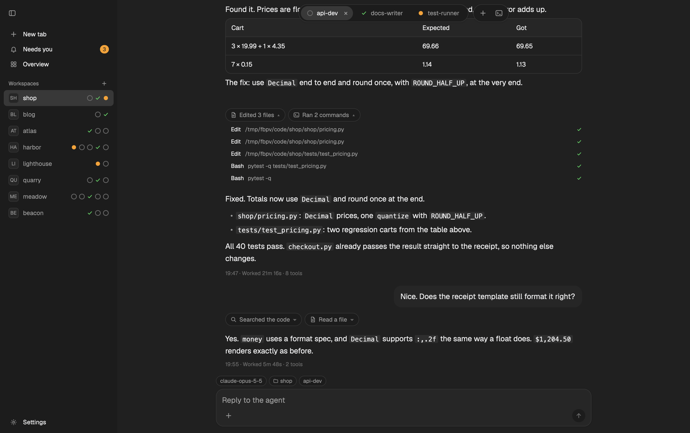

# Flockbook for herdr-app



More screenshots (cards, Needs you, Overview, attachments, the terminal, menus and the floating sidebar) are in the [repository README](../README.md#flockbook-for-the-herdr-app).

Flockbook's reading view, rebuilt as a herdr-app layout and mod. It shows each coding agent as a
conversation instead of a terminal: a floating tab bar with one pill per agent, chat bubbles,
tool-call chips, a status tag row, and a composer.

It needs no change to herdr-app. Where herdr-app's mod API cannot do what Flockbook does, this
version comes close or leaves the feature out.

## Parts

| Path | What it is |
|---|---|
| `layouts/flockbook.json` | The window: a hidden sidebar and a stack of screens (chat, Needs you, Overview, the tab's panes). Each screen draws the top bar. |
| `mods/flockbook/` | One mod with several views. Each layout block picks one with `props.view`: `top`, `side`, `chat`, `needs`, `overview`; popups use `termbar` and `menu`. |
| `themes/` | Flockbook and Flockbook Mac themes, dark and light. |
| `test/` | Node tests with fake `gpui-kit`, `gpui-base` and `herdr` modules. |
| `keys.json` | The Flockbook shortcuts, in a `layout:flockbook` section (while this layout shows). Do not add a `mod:flockbook` section: with one, no key worked. |
| `install.sh` | In the release zip: runs this machine's helper (`bin/` on macOS, `remote/<target>/` on Linux, checked against `remote/SHA256SUMS`) as `flockbook-modfeed install`, which installs the layout, the mod, the themes, the keys and the helpers into your herdr-app home, without overwriting yours. |
| `install-isolated.sh` | Copies the same into a test herdr-app home, for development. |

The chat view reads conversations through a sidecar, `flockbook-modfeed`, built from this repo
(Rust: `cd xplat && cargo build --release -p flockbook-modfeed`; the Swift one,
`swift build -c release --product flockbook-modfeed`, speaks the same protocol). The mod finds it at
`<herdr-app home>/flockbook/bin/flockbook-modfeed`. Its protocol is in `docs/protocol.md`.

The layout and the mod work only together: the layout names the mod's views, and the mod expects
the layout's ids (`sidebar`, `screen`, `chat`, `tab`). The mod alone draws nothing (`place` is
`none`); the layout alone shows empty blocks where the views should be. The keys and themes are optional.

A mod cannot import files from another mod's folder, so all views live in one mod.

The sidebar column has the id `sidebar`, so herdr-app's own ⌘B (`layout.toggle:sidebar`) opens and closes it.

## Install

This needs herdr-app on macOS or Linux. The mod runs programs: its helper `flockbook-modfeed` (which runs
`hc` and sends keys and text to an agent's terminal, only when you press or type) and, on macOS,
`osascript` (the file dialog). On Linux the + file dialog is off: drop files on the chat or paste an image. It reads the agents' session logs outside its folder (`~/.claude/projects/`,
`~/.codex/sessions/` and others; see `RECIPE.md`). It goes on the network only to check once a day for
a newer Flockbook (api.github.com); turn it off in the Flockbook settings (sidebar, **Flockbook**), which
also has the status row and the helper on other machines. They are kept in `flockbook/config.json`.

`flockbook-modfeed install` (the layout, the mod, the themes and the keys are built into the helper)
copies them into your herdr-app home, merges `keys.json`, puts the helper in `flockbook/bin/` and the
helpers for other machines in `flockbook/remote/<target>/` (checked against `SHA256SUMS`), and runs
`herdr-app check`. It needs no python3. It never overwrites what you
have: if a layout, mod or theme called flockbook is there and it did not put it there, it stops
and writes nothing. The one exception is an older Flockbook nobody changed (a gallery copy, an older
zip): each file whose checksum is one of an earlier version's is replaced, and the plan names the
version. A key you already use keeps your command. Add `--dry-run` to see the plan
first. The home is `--home <folder>`, else `$HERDR_APP_HOME`, else `~/.config/herdr-app`.

In one line (macOS or Linux): it downloads the helpers and `SHA256SUMS` from the latest release,
stops if a sum does not match, and runs `flockbook-modfeed install` (add `-s -- --dry-run` after `sh`):

```sh
curl -fsSL https://github.com/minchenlee/flockbook/releases/latest/download/install.sh | sh
```

From a release zip: download `Flockbook-herdr-mod-<version>.zip` from
<https://github.com/minchenlee/flockbook/releases>. It has this folder's layout, mod, themes, keys
and install scripts, a universal, signed `flockbook-modfeed` in `bin/`, and the helper for each
platform in `remote/<target>/` (`universal-apple-darwin`, `x86_64-unknown-linux-musl`,
`aarch64-unknown-linux-musl`) with `remote/SHA256SUMS`. Unzip it, then:

```sh
./install.sh --dry-run
./install.sh
```

From the repo (in its root):

```sh
(cd xplat && cargo build --release -p flockbook-modfeed)
xplat/target/release/flockbook-modfeed install --helper xplat/target/release/flockbook-modfeed
```

From the gallery (herdr.dev/layouts): the agent copies only `layouts/` and `mods/`. Get the
helper from a release or build it as above, and copy it to
`<herdr-app home>/flockbook/bin/flockbook-modfeed`. Without it the chat says the helper is
missing; the other views work.

Then pick the layout in herdr-app with `layout.switch {"name": "flockbook"}`. `ctrl-shift-l`
switches back to your own layout.

## Try it in a test home

For development, install into a test home instead of your real one. `install-isolated.sh` refuses
`~/.config/herdr-app` and replaces its own earlier copy without asking:

```sh
mkdir -p /tmp/flockbook-test-home
./install-isolated.sh /tmp/flockbook-test-home path/to/flockbook-modfeed
HERDR_APP_HOME=/tmp/flockbook-test-home herdr-app check /tmp/flockbook-test-home/mods/flockbook
```

Then start herdr-app with `HERDR_APP_HOME=/tmp/flockbook-test-home` and pick the layout with
`layout.switch {"name": "flockbook"}`.

## Tests

```sh
npm test
```

## Release notes

Each change people can see adds one line to the repo's `docs/release-notes/next.md`.
