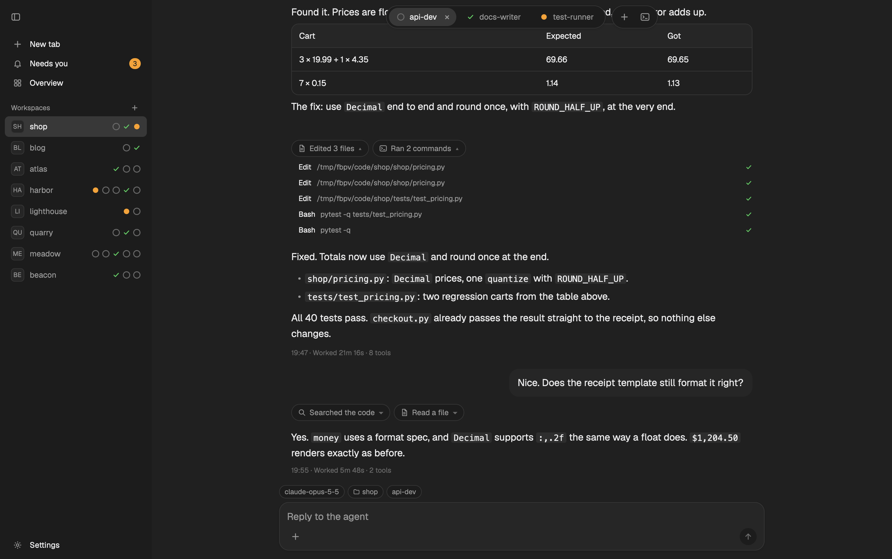

# Flockbook

A reading view for coding agents. Each tab with an agent shows as a conversation instead of a
terminal: user messages in bubbles, the agent's replies as markdown with rounded code boxes and
tables, tool calls folded into chips, and a reply box under it. A floating bar at the top has one
capsule per tab with a status mark. When an agent asks for permission or asks a question, a card
above the reply box answers it. Needs you lists every agent that waits; Overview shows every tab as
a card. The sidebar is hidden and slides out from the window's left edge.

## What you see

The window has no title bar. The macOS window buttons sit at 18, 22. The theme is black and white
(`flockbook` dark, `flockbook-light` light); the Mac themes (`flockbook-mac`, `flockbook-mac-light`)
use blue `#007aff` for working, green `#34c759` for done and orange `#ff9500` for blocked.
Dark colors: the window shows `#0b0b0b` behind the chat and the sidebar alike (the theme names
canvas `#000000` and chrome `#0b0b0b`; the window paints both `#0b0b0b`), raised `#161616`, hover
`#1c1c1c`, selected `#262626`, border `#363636`, muted `#9a9a9a`, dim `#5f5f5f`, accent and
foreground `#ededed`.

Left to right:

1. **Sidebar** (250 px, 220 to 320, hidden by default, `chrome` background, 1 px `border` divider).
   Top to bottom:
   - A 56 px header with a round 28 px sidebar button, at the same spot as the bar's sidebar button.
   - Rows, 30 px tall, 13 px text, a 22 px icon column: **New tab**, **Needs you** (an orange pill
     with the count when agents wait), **Overview**. The row for the shown screen is `selected`.
   - A "Workspaces" heading (11.5 px, semibold, muted) with a small + on the right.
   - One 34 px row per space: a 22 px monogram square (two letters, 10.5 px), the name, and the
     status marks of its tabs on the right (all up to 5, else the first 3 and "+N").
     Drag a row up or down to move the workspace (`space.move`): a 2 px `accent` line in the gap
     shows where it goes, the row dims, and the release moves it there. A move under 4 px is a
     click. Leaving the list, another mouse button or a press elsewhere cancels. The same in the
     floating sidebar. The tab drag in the top bar and this one share `drag.js`.
   - At the bottom: the update line when a newer Flockbook is out (a `raised` 8 px box: "Flockbook
     X.Y.Z is out", then **Copy install command** and **Not now**), a **Flockbook** row (the
     Flockbook screen), and **Settings**.
   While the sidebar is hidden and a newer Flockbook is out, the top bar's sidebar button has a 7 px
   `accent` dot, until the sidebar opens (docked or floating) or **Not now**.
2. **Work area**: a stack of five screens. The bar floats over the first four.
   - **Top bar** (56 px, over the content, no background of its own). The sidebar button (28 px,
     round, with a `chrome` backing) sits right of the window buttons while the sidebar is hidden.
     Centered: a tab capsule and a tools capsule, both 38 px tall, fully round, `chrome` with a 1 px
     border and a small shadow.
     - The tab capsule has one 30 px pill per tab that is not put away: a status mark, then the
       label (13 px, at most 170 px, cut with an ellipsis). The shown tab is `selected`, semibold,
       with a × to close it. The capsule scrolls sideways when the tabs do not fit.
     - The tools capsule has **+** (new tab) and a terminal button (the agent's terminal).
   - **Chat**: a reading column at most 760 px wide, 24 px gutters, centered.
     - User message: a right-aligned bubble, at most 78% of the column, 16 px corners, `raised`.
       "1 image" or "N images" under it when it had pictures.
     - Agent reply: full-width markdown, 16 px text, 26 px lines (the `TextView` default; a mod
       cannot change it). Code fences are 12 px rounded boxes (`raised`,
       1 px border, Menlo 13 px, 19 px lines). Tables are 12 px rounded frames: a `raised` header
       row, 1 px lines between rows, columns sized to their content.
     - Tool calls: a row of 28 px round chips ("Ran 3 commands", an icon per kind: terminal, doc,
       search, tool), each with ▾. A spinner while a call runs.
     - A pending call: a 28 px chip "Running · <what>" with a spinner.
     - Separators and footers in 11.5 px dim text.
     - A round 34 px ↓ button at the bottom center while you read older messages.
     - "Loading earlier messages" in a small capsule under the bar while older rows load.
   - **Reply box** under the chat, at most 800 px wide: a row of 22 px round tags (model, effort,
     context, cost, folder, branch, agent; a warning tag is orange), then a 16 px rounded `raised`
     box with a one-line text area ("Reply to the agent"), + to attach files on the left (macOS only), the
     branch, and a round 28 px send button (accent when there is text). File chips above the text.
   - **Card** between the chat and the reply box, at most 800 px, 14 px corners, `raised`, 14 px
     padding, an orange 8 px dot before the title.
     - Approval: the title (the prompt's own, for example "Bash command"; else "<tool> wants to
       run"), the command in Menlo 12.5 px on `background`
       (at most 140 px, scrolls), then **1 Allow once** (accent) and **2 Deny**.
     - Question: "Question 1 of N" with dots, the question, options as rows with a round (one
       choice) or square (several) mark, "Recommended" in accent, a number hint per option, an
       "Or type your own answer" row, then "1-9 picks · Enter goes on" on the left and Back,
       Next or **Send answer** on the right.
   - **Needs you**: a 340 px list on the left ("Needs you · N", 52 px rows: the program icon,
     the name, "<space> · waits for you", an orange dot) and the picked agent on the right (name in
     18 px, its title, its card, an **Open chat** button). With none: a green check, "All clear",
     "No agent waits for you."
   - **Overview**: at most 1220 px wide. A greeting ("Good morning", 26 px), "N tabs · N working ·
     N need you", and a "Group by Status | Workspace" switch. Then groups of 64 px cards (1 to 3
     columns, at least 300 px each, 12 px gaps): a status mark, the tab label (14 px semibold), how
     long ago it changed ("13m"), and the space and agent in 12 px muted.
   - **Flockbook**: at most 640 px wide. "Flockbook" (18 px), "Saved in <file>. Changes apply at
     once." (12 px muted), then one row per setting (the name in 13.5 px, a line on what it does in
     12 px muted, and on the right a two-choice switch: 26 px choices in a `chrome` frame, the chosen
     one `selected` and semibold): **Check for updates** On | Off, **Status row** Show | Hide,
     **Helper on other machines** Ask | Never. A box with a `blocked` border when config.json is not
     JSON. The update line with the command written out (Menlo 11.5 px) when one is out.
   - **Tab panes**: a split tab, or a tab with a shell, shows its own panes (a 56 px top bar
     above them, 8 px padding, 6 px gaps, 8 px corners, 1 px border, `muted` border on focus).

Status marks: working is a 13 px spinner (`working` color, one turn per 600 ms); done is a check
(`done`); blocked is a 9 px dot (`blocked`); idle is a 12 px empty ring (`dim`).

## How it behaves

- **Tabs**: click a pill to show that tab. A tab with one agent shows the chat; a split tab or a
  shell shows its panes. Right-click a pill: Rename…, Move left, Move right, Open terminal,
  Show chat or Show panes, Split right, Split down, Put away, Close tab. Drag a pill to move its
  tab: a line shows where it goes, and the release moves it there. Dragging out of the bar
  cancels (the tab stays), and so does another mouse button. Esc does not cancel: the bar does
  not take the keyboard from the chat or the terminal.
- **Chat**: opens at the newest message and follows new ones. Scrolling up stops following; the ↓
  button goes back to the end. Older messages load only when you scroll up past the first row.
  A click on a tool chip opens its calls (name, summary, a check, a spinner, or "failed").
  Another agent's chat fades in.
- **Reply**: Enter sends (the text area's submit). Drop files on the chat or click + (the
  macOS file dialog; on Linux and Windows there is no +, since a mod has no file picker) to attach them. ⌘V (Ctrl+V on Linux): files copied in Finder or a file manager are attached; else
  plain text is typed (also when a picture comes with it, as from Excel, Numbers or Word); else an image (a
  screenshot, a browser's Copy Image) is attached as a PNG.
  If the text did not go out, it stays in the box with a red note. "Sent. The agent did not
  confirm it yet." when the core did not answer in time.
- **Approval card**: 1 allows once, 2 denies (with the card focused). After an answer the buttons
  turn off and the card says "Answer sent. Waiting for the agent." until the prompt leaves.
  "It changed on screen. Here is what it shows now." when the prompt on screen is another one.
- **Question card**: 1-9 picks an option (a one-choice pick moves on); the number after the
  options moves the keyboard into the own-answer box; Enter goes on or sends. With more questions
  behind the first: **Show all N questions** reads them all from the agent's picker.
- **Flockbook settings** (the Flockbook row, or ⌘⇧,): saved in `<herdr-app home>/flockbook/config.json`
  as `{"check_updates": true, "status_row": "show", "remote_helper": "ask"}`. The install never
  creates the file; a missing file or key is the default, and so is a value that is not one of the
  choices. A file that is not JSON is the defaults too: the screen says so, and its switches do
  nothing until the file is fixed or removed (it is never overwritten). A change keeps the other keys,
  is written against the text just read (someone else's change is read again, not lost), and every
  view shows it at once. The file is read again each minute and when the screen opens.
  - **Check for updates** On: the mod asks the helper (`update-check`) at most once an hour; the
    helper asks GitHub at most once a day. A newer release shows the update line; **Copy install
    command** puts the one-line install on the clipboard; **Not now** hides it until a newer one.
    Nothing shows when it is current, offline, or on any error. Off: nothing is asked.
  - **Status row** Hide: no tags (model, context, cost, folder, branch) above the reply box (the branch beside the send button stays).
  - **Helper on other machines** Never: for a tab on another machine the chat says, in one line,
    "Flockbook does not run its helper on other machines. To change it: Flockbook settings, Helper
    on other machines: Ask." No install card; the tab menu has "Remove helper: choose Ask in Flockbook
    settings first…" (it opens them) in place of Remove helper; and the helper
    itself refuses every command for a terminal there and `helper install` / `remove` (`remote-off`). To remove a helper that is
    already there, choose Ask first.
- **Sidebar**: ⌘B or the sidebar button shows and hides it. With it hidden, the pointer at the
  window's left 4 px slides it out as a floating panel (260 px wide, 8 px from the edges, 14 px
  corners, a large shadow), which closes when the pointer leaves it, on Esc or a click beside it.
  Right-click a space: New tab here, Rename…, Close workspace….
- **Agent's terminal**: ⌃` or the terminal button opens the agent's real terminal in a floating
  window (70% of the window, 16 px corners) with a 42 px title bar (a terminal chip, the name,
  "Terminal", a round close button). ⌃` again closes it.
- **Keys** (while this layout shows): ⌘T new tab, ⌘W close tab, ⌘⇧N new space, ⌘1-⌘9 a tab,
  ⌘⇧[ / ⌘⇧] or ⌃Tab / ⌃⇧Tab the tab before or after, ⌘⌥↑ / ⌘⌥↓ the space before or after,
  ⌘⌃⇧← / ⌘⌃⇧→ move the tab, ⌘⇧I Needs you, ⌘⇧\ Overview, ⌘B sidebar, ⌃` terminal,
  ⌘= / ⌘- / ⌘0 zoom, ⌘, settings, ⌘⇧, Flockbook settings, ⌘/ help. On the Flockbook screen,
  Tab moves through the choices and Enter or Space picks one.

## Built from

- **Layout** `layouts/flockbook.json`: a `row` (`titlebar: "none"`, `traffic_lights: [18, 22]`,
  background `canvas`, theme light `flockbook-light` / dark `flockbook`) with:
  - `sidebar`: a `column`, 250 px (min 220, max 320), `hidden`, `chrome`, a 1 px divider, holding
    one block `side`.
  - `work`: a `column` holding the `stack` `screen` (active `chat`) with the blocks `chat`,
    `needs`, `overview`, `settings` (each `window_drag`) and the `column` `tab`: the block `top` (56 px) above
    `tab-panes` (`content: {tab: "active", pane: {gap 6, radius 8, border 1 border, focus 1 muted}}`,
    padding 8).
  - The ids `sidebar`, `screen`, `chat` and `tab` are what the mod switches.
- **Mod** `mods/flockbook/` (`mod.json`: `place: "none"`): one mod, one view per block, picked
  by `props.view`: `side`, `chat`, `needs`, `overview`, `settings`, `top`; overlays use `termbar` (the terminal
  window's bar), `menu` (right-click menus) and `side` with `peek: true` (the floating sidebar).
  All views are in one folder because a mod cannot import another mod's files.
- **Shared state** (`shared` / `setShared`): `flockbook.agent` (the agent shown),
  `flockbook.screen` (the shown screen), `flockbook.sidebar`, `flockbook.sidebar.peek`,
  `flockbook.terminal`, `flockbook.window.height`, `flockbook.command`, `flockbook.overview.group`,
  `flockbook.config` (the settings file, parsed), `flockbook.update` and `flockbook.update.at` (the
  last update line, and when the mod asked).
- **herdr functions**: `spaces`, `agents`, `panes`, `focused`, `theme`, `layout`, `window`,
  `settings`, `props`, `run`, `nextCommand`, `setAgentOrder`, `openOverlay`, `closeOverlay`,
  `exec`, `appHome`, `home`, `readTextFile`, `writeTextFile` (config.json only).
- **Commands it runs**: `layout.select {stack: "screen", child}`, `layout.show` / `layout.hide
  {id: "sidebar"}`, `tab.select`, `tab.close`, `tab.move`, `tab.rename`, `tab.settle`, `tab.new`,
  `pane.split`, `space.select`, `space.new`, `space.rename`, `space.close`, `agent.focus`,
  `app.settings`. Its own key commands: `flockbook.terminal`, `flockbook.needs`,
  `flockbook.sidebar`, `flockbook.overview`, `flockbook.settings`, `flockbook.move-left`,
  `flockbook.move-right`.
- **Shipped mods**: `new-menu` (the + popup, 250 × 512).
- **Programs**:
  - `flockbook-modfeed`, a helper program at `<herdr-app home>/flockbook/bin/flockbook-modfeed`
    (make it executable). The gallery copies only `layouts/` and `mods/`, so get the helper on its
    own: the release's one-line install
    (`curl -fsSL https://github.com/minchenlee/flockbook/releases/latest/download/install.sh | sh`)
    or the zip's `./install.sh` puts it there. The zip `Flockbook-herdr-mod-<version>.zip` at
    <https://github.com/minchenlee/flockbook/releases> has it for macOS (`bin/`, signed universal) and
    Linux (`remote/<target>/`); or build it from that repo with
    `(cd xplat && cargo build --release -p flockbook-modfeed)`. It reads each agent's session log
    (`~/.claude/projects/`, `~/.codex/sessions/`, `~/.grok/sessions/`, `~/.cursor/projects/`,
    `~/.pi/agent/sessions/`, `~/.gemini/antigravity-cli/`) and talks to herdr-core (`hc`) to read
    screens and send keys and text. Commands: `feed`, `status`, `card`, `approve`, `answer`,
    `send`, `paste-image`, `helper`, `update-check`, one per `exec`, JSON Lines back
    (`herdr-app/docs/protocol.md` in that repo). Every call ends with `--home <herdr-app home>`, so
    the helper follows the same config.json. It keeps `<herdr-app home>/flockbook/cache.json`, `answered/` beside it, and pastes in
    `<herdr-app home>/flockbook/paste/`.
  - `osascript`, for the file dialog (macOS only; the + button shows only when `window().platform` is `macos`).
  - It reads `<herdr-app home>/layouts/.state/flockbook.json` once, for whether the sidebar was open.
- **Themes** `themes/flockbook.json`, `flockbook-light.json`, `flockbook-mac.json`,
  `flockbook-mac-light.json`.
- **Keys** `keys.json`: one `layout:flockbook` section.
- **Art** `mods/flockbook/icons/`: arrow-down, bell, branch, check, close, doc, folder, gear, grid,
  plus, search, send, sidebar, sliders, spinner, split, terminal, tool (16 × 16 SVG, 1.8 px round strokes, `currentColor`).

## Watch out

- The mod alone draws nothing, and the layout alone shows empty blocks. Copy both, and the themes
  the layout names.
- Without the helper, the chat says "The Flockbook helper is missing. Get it from
  github.com/minchenlee/flockbook/releases." Every other view still works.
- Tell the person before adding it: the mod runs programs (`exec` of the helper and `osascript`;
  the helper runs `hc` and sends keys and text to agents' terminals, only on a press or a key), and
  reads files outside its folder: the agents' session logs (`~/.claude/projects/`,
  `~/.codex/sessions/` and the others under Programs) and `<herdr-app home>/layouts/.state/`.
- It reaches the network once a day: the helper asks `api.github.com` for the latest Flockbook
  release (curl, 5 s at most) and keeps the answer in `<herdr-app home>/flockbook/update-check.json`.
  To turn it off: Flockbook settings, Check for updates: Off, or `{"check_updates": false}` in
  `<herdr-app home>/flockbook/config.json`. Off, it asks nothing. A helper built from source has no
  release version and never asks. Nothing else goes on the network.
- Do not add a `mod:flockbook` section to `keys.json`: with one, no key worked.
- ⌘V in the reply box: the text box's own paste runs before any `on_key_down`, so a key handler never
  sees it, and a Finder copy (file names as text) came in as names. The mod binds `secondary-v` with
  `cx.bind_keys` under its own key context (`FlockbookComposer > Input`), asks `paste-image` first
  (files, then plain text, then an image), and types the text itself when nothing is attached.
- `layout()` is the file, not the live tree. Keep the shown screen and the sidebar state in shared
  state, and select the screen outright.
- A mouse move carries no button state and arrives only over the element under the pointer, so
  a release outside the bar is never seen. The tab drag ends when the pointer leaves the bar.
- Each screen draws its own top bar, so each copy runs the bar's work. Two copies can get one key
  command: the first acts, and the others skip it within 150 ms (`flockbook.command`).
- The chat is a `v_virtual_list` with guessed heights (16 px text, 26 px lines, the `TextView`
  default that a mod cannot change; wide letters counted as 16 px, the rest 0.5 × 16, one
  letter of width kept free), because `list` cannot be scrolled from code and the chat
  must open at the end. A guess too low cuts a row; guesses lean high.
- `TextView.markdown` takes no style and draws code and tables square. Split the text into blocks
  and draw fences and tables yourself. A `TextView` in a flexible cell keeps its one-line width
  and spills out: give table cells a fixed width.
- `openOverlay` with `at: "pointer"` uses a pointer position that is not updated while the pointer
  is over an overlay window. The floating sidebar opens its menus at the press's own position.
- A popup sizes to its content and ignores a height. The floating sidebar is a frameless `window`
  overlay sized from the window height the views note.
- Keys go out only on a press or a key, never on a timer. The helper checks the screen again right
  before every key: a prompt that changed sends nothing. One approval goes out once per prompt.
  A reply goes only to the agent and conversation the chat showed.
- Esc goes to the terminal in the terminal window, so its title bar has the close button.
- Built and tried on macOS only. The helper needs herdr-core running; agents it reads: Claude
  Code, Codex, Grok Build, Cursor, pi, Antigravity CLI.

## Done when

- `<herdr-app home>/flockbook/bin/flockbook-modfeed version` prints a JSON line with `"protocol"`.
- `herdr-app check mods/flockbook` passes, and `layout.switch {"name": "flockbook"}` shows the bar
  with one pill per tab of the shown space, each with its status mark.
- A tab with a Claude Code agent shows its conversation, at the newest message, and a new reply
  from the agent appears without a click.
- A reply with a code fence and a table shows a rounded code box and a rounded table whose text
  stays inside its cells.
- Typing in the reply box and pressing Enter puts the text into the agent's terminal.
- ⌘V in the reply box after copying a file in Finder attaches the file (no name typed); after a
  screenshot to the clipboard it attaches a PNG; after copying text it types the text at the cursor.
- A Claude permission prompt shows the approval card with the same command; 1 allows it once, and
  the buttons turn off until the prompt leaves.
- A question picker shows the question card; picking and Send answer answers it in the terminal.
- ⌘⇧I shows Needs you with the waiting agents; ⌘⇧\ shows Overview with every tab.
- With the sidebar hidden, moving the pointer to the window's left edge slides out the floating
  sidebar, and it closes when the pointer leaves it.
- ⌃` opens the agent's terminal window; ⌃` again closes it.
- Dragging a pill onto another pill moves that tab there, also with the bar scrolled; dragging it
  out of the bar and releasing moves nothing.
- Dragging a workspace row onto another row moves that workspace there, in the docked and the
  floating sidebar; dragging it out of the list and releasing moves nothing.
